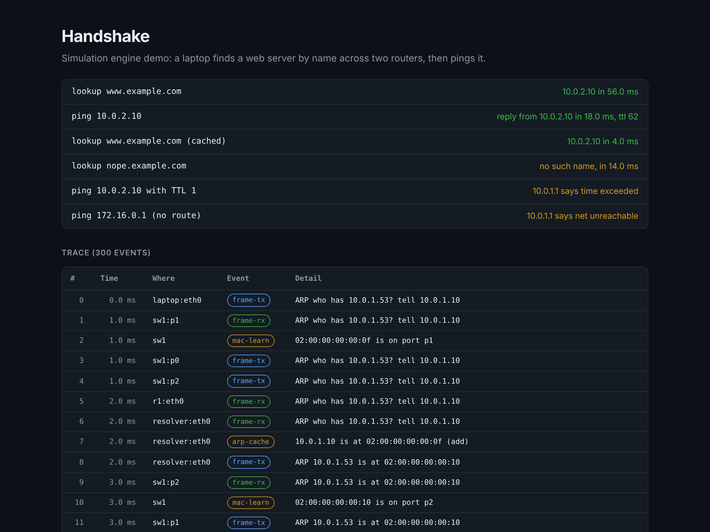

# Handshake

A playable internet in the browser. Build a network from hosts, switches and routers, watch packets move
through it, then attack and defend it. Everything is simulated: no real traffic ever leaves the page.



## Status

The simulation engine handles Ethernet, switching, ARP, IPv4 routing, ICMP, UDP and DNS. The page you get
from `npm run dev` is a placeholder that runs a fixed scenario and lists the event trace.

| Step | What | State |
| --- | --- | --- |
| 1 | Simulation engine: Ethernet, switch, ARP, IPv4, ICMP | Done |
| 1 | Simulation engine: UDP, DNS | Done |
| 1 | Simulation engine: TCP | Next |
| 2 | Canvas renderer and packet inspector | Not started |
| 3 | Timeline recording and scrubbing | Not started |
| 4 | Attack and defence modules | Not started |
| 5 | Multiplayer and AI scenarios | Not started |

## Commands

```bash
npm install
```

```bash
npm run dev
```

```bash
npm test
```

```bash
npm run build
```

## The engine

`src/engine` has no dependency on the browser, so it runs the same in tests, in the page and later on a server.

```ts
import { Host, Router, Simulation, Switch } from './src/engine';

const sim = new Simulation({ seed: 1 });
const laptop = new Host(sim, 'laptop', { address: '10.0.1.10/24', gateway: '10.0.1.1' });
const server = new Host(sim, 'server', { address: '10.0.2.10/24', gateway: '10.0.2.1' });
const sw = new Switch(sim, 'sw1');
const router = new Router(sim, 'r1');

sim.connect(laptop.nic, sw.freePort());
sim.connect(router.addInterface('10.0.1.1/24'), sw.freePort());
sim.connect(router.addInterface('10.0.2.1/24'), server.nic);

laptop.ping('10.0.2.10', (result) => console.log(result));
sim.runUntilIdle();
console.log(sim.trace); // every frame sent, received, dropped, and every table change
```

### DNS

Name lookups work the way they do on the real internet. A host asks its recursive resolver; the resolver
starts at a root server and follows referrals down to the server that holds the answer, caching what it
learns for as long as each record allows.

```ts
import { DnsResolver, DnsServer, aRecord, nsRecord } from './src/engine';

new DnsServer(rootHost, [
  { origin: '', records: [nsRecord('com', 'a.gtld-servers.com'), aRecord('a.gtld-servers.com', '10.0.2.3')] },
]);
new DnsServer(tldHost, [
  { origin: 'com', records: [nsRecord('example.com', 'ns1.example.com'), aRecord('ns1.example.com', '10.0.2.4')] },
]);
new DnsServer(ns1Host, [{ origin: 'example.com', records: [aRecord('www.example.com', '10.0.2.10')] }]);
new DnsResolver(resolverHost, { rootServers: ['10.0.2.2'] });

const laptop = new Host(sim, 'laptop', { address: '10.0.1.10/24', gateway: '10.0.1.1', dnsServers: ['10.0.1.53'] });
laptop.lookup('www.example.com', (result) => console.log(result)); // { status: 'ok', addresses: [...] }
```

The resolver already has the defences that DNS poisoning has to get past: a random source port and
transaction id for every query, a check that each response matches the question asked, and a refusal to
believe a server about names outside the zone it was asked about. Each rejected response is recorded in the
trace as a `dns-reject` event.

Not modelled: record types other than A, NS and CNAME, SOA-driven negative caching (a fixed 60 seconds is
used), truncation and TCP fallback, and DNSSEC.

### Design rules

- **Deterministic.** Time is a counter of simulated microseconds, events at the same instant run in the order
  they were scheduled, and all randomness comes from generators derived from one seed. The same seed and
  inputs always give the same trace. The engine never reads the wall clock or `Math.random`.
- **Everything is recorded.** Each frame sent, received or dropped and each table change is appended to
  `sim.trace` as plain data. The renderer and the timeline will be built on this log.
- **Packets are immutable objects**, not byte buffers, so the inspector can show them as they are. A router
  copies a packet to lower its TTL.
- **Protocols behave like the real ones.** ARP follows RFC 826, including trusting whoever spoke last, which
  is what makes ARP spoofing possible later without special-casing it.

### Layout

| File | Contents |
| --- | --- |
| `sim.ts` | Event queue, clock, trace, cabling |
| `addr.ts` | MAC, IPv4 and CIDR helpers |
| `packets.ts` | Ethernet, ARP, IPv4, ICMP and UDP shapes |
| `link.ts` | Interfaces and cables, with latency, loss and link failure |
| `switch.ts` | Learning switch with address aging |
| `arp.ts` | Per-interface ARP cache |
| `ipnode.ts` | The IP layer shared by hosts and routers: routing table, ARP resolution, ICMP, forwarding |
| `udp.ts` | UDP sockets: bound and ephemeral ports, delivery, errors reported back by the network |
| `dns.ts` | DNS messages, records and name helpers |
| `dns-server.ts` | Authoritative server: answers, referrals, aliases |
| `dns-resolver.ts` | Caching recursive resolver |
| `dns-client.ts` | The stub resolver on every host |
| `host.ts`, `router.ts` | The two kinds of IP device |
| `trace.ts` | Trace event types and one-line descriptions |
